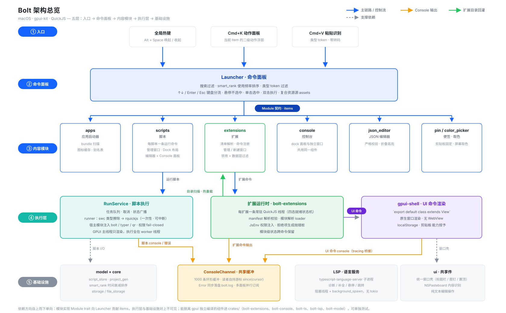

# 代码结构与架构

> `src/` 的领域分层、目录职责、`crates/` 独立 crate 与贯穿性设计决策。
> 返回总览见 [README](../README.md)。

## 架构总览

读图顺序自上而下，依赖方向单向指下：

| 层 | 职责 | 主要落点 |
| --- | --- | --- |
| ① 入口 | 用户以三种方式唤起命令：全局热键、Cmd+K 二级动作、Cmd+V 粘贴识别 | `app/hotkey`、`app/launcher` |
| ② 命令面板 | Launcher 收集 items、过滤、排序、键盘分流；对具体模块一无所知 | `app/launcher/` |
| ③ 内容模块 | 各自实现 `Module` trait，向 Launcher 贡献 items，自管窗口与状态 | `modules/` |
| ④ 执行层 | 脚本与扩展命令在两个不同的运行时里执行；UI 命令交给 gpui-shell 原生渲染 | `runtime/`、`host/`、`crates/bolt-extensions` |
| ⑤ 基础设施 | 领域数据、Console 缓冲、语言服务、跨模块 UI 件 | `crates/bolt-model`、`crates/bolt-console`、`crates/bolt-lsp`、`core/`、`ui/` |

图只画主链路。几条贯穿性约束值得先记住：

- **执行永远不在渲染线程上**：GPUI 主线程只渲染，脚本与扩展命令都在独立线程跑，输出经 `ConsoleChannel` 回到视图。
- **Launcher 不认识模块**：它只消费 `Module` trait 产出的 `LauncherItem`，新增功能不需要改 Launcher。
- **扩展校验 fail-closed**：清单没声明的权限一个都不给，拒绝项在转发模块里生成抛错桩。
- **扩展目录是热的数据源**：磁盘改了下次唤出即生效（同版本内容变更会重载），不需要重启应用。

## 目录职责

### 入口与装配

- [src/main.rs](../src/main.rs) — 仅 `mod` 声明 + `app::boot::run()`。
- [src/app/](../src/app) — 进程装配与窗口生命周期。

  | 文件 | 职责 |
  | --- | --- |
  | `boot` | 启动序列：数据目录 → 注册内置宿主模块 → 生成工程文件 → LSP → GPUI |
  | `shell` | `AppShell` 全局状态与共享服务（Console 通道、扩展 store、运行服务） |
  | `hotkey` | 全局热键注册与轮询 |
  | `launcher/` | 应用主 UI：通用命令面板，不知道任何具体模块 |
  | `windows` | Launcher 窗口单例、被确认 item 的分发（走 app tick，见下） |
  | `assets` | 内置图标 + 已打开扩展目录的复合资源源 |
  | `shell_log` | gpui-shell 的 `tracing` → Console 缓冲桥 |

  `launcher/` 内部按职责拆分：`item` 定义 `LauncherItem` / `Module` 契约，`collect` 收集与排序，`filter` 查询与粘贴过滤，`actions` 动作构建，`list` 自绘列表（悬停不选中、单击选中、双击执行），`panel` Cmd+K 浮层，`mod` 主视图与键盘分流。搜索框是宿主自己的 `Input`：类型 token、Cmd+V 粘贴识别、文本过滤、↑↓/Enter/Esc 分流都在宿主侧完成。

### 内容模块

[src/modules/](../src/modules) 下每个目录都是一个自包含模块，实现 `Module` trait 为 Launcher 提供 items，窗口单例与专属资源放各自的 `state.rs`（Global）。

| 模块 | 内容 |
| --- | --- |
| `apps/` | 应用启动器：bundle 扫描、`InfoPlist.strings` 本地化解析、图标缓存、可编辑别名表 |
| `scripts/` | 脚本管理器窗口（Dock：脚本列表 + 编辑器 + Console）+ 每条脚本一条运行命令 |
| `json_editor/` | 原生 JSON 编辑器窗口（严格校验、折叠、高亮） |
| `pin/` | 「Pin 剪贴板」便签：把剪贴板图片/文本固定成桌面悬浮窗口，支持置顶、缩放、另存、复制回剪贴板。`clipboard.rs` 只做 pin 专属的一层转换（宿主公共 `PasteContent` → 便签展示类型，并给出便签尺寸） |
| `console/` | `panel` 是 Console 视图（管理器的 dock 面板与独立窗口共用同一个组件）、`chrome` 决定要不要自绘标题栏、`window` 是独立窗口单例开窗逻辑 |
| `extensions/` | 扩展：`manifest` 目录扫描与播种、`host` 与注册表对接 + 清单快照 `inventory()`、`js_env` 宿主注入、`exec` 脚本命令、`ui_window` UI 命令窗口、`prefs` 禁用列表、`actions` 扩展级动作（Launcher 与管理窗口共用）、`ops` 重载/禁用/卸载、`manager/` 管理窗口、`create/` 新建扩展窗口、`scaffold` 模板生成与 `.d.ts` 落盘 |
| `color_picker/` | 屏幕取色：覆盖鼠标所在显示器的透明浮窗 + 全屏放大镜拾色，复制 HEX 色值 |

### 平台边界

[src/platform/](../src/platform) 是宿主唯一允许出现平台差异的地方：

- `mod.rs` — 与平台无关的部分：`open_in_background` / `reveal_in_background` 的工作线程与回调调度（**GPUI 回调里只能用它们打开/选中路径**，原因见「窗口与系统集成」）、废纸篓的文件系统回退 `move_to_trash`、剪贴板写入 `copy_text` 的公共入口。
- `macos.rs` — `/usr/bin/open`、NSPasteboard、`NSFileManager` 废纸篓、三处 `/Applications`、`CGDisplay` 坐标翻转。
- `windows.rs` — `open` / `trash` / `arboard` 三个 crate + `explorer /select,`、开始菜单扫描根、`cmd /C`。
- `unsupported.rs` — 其余平台：明确报错，不静默成功。

### 跨模块 UI

[src/ui/](../src/ui) 放不属于任何单一模块的前端逻辑：

- `window/` — 统一窗口壳：`title_bar` 自绘标题栏构建器、`pin` 无状态置顶图钉、`open` 开窗样板与默认置顶、`level` NSWindow 层级 FFI、`tooltip` 原生提示气泡。
- `interaction_window` — 宿主交互浮层（确认框、输入、进度）。
- `editor_ops` — 不依赖 gpui 上下文的纯文本编辑操作，可单测。
- `clipboard/` — NSPasteboard 读取与内容识别：`mod` 类型与 peek/read 入口、`files` Finder 文件条目、`html` 富文本转纯文本、`image` 格式与尺寸识别。`read_paste_content` 供 Launcher Cmd+V 与 pin 共用。

### 领域数据与执行

| 目录 | 职责 |
| --- | --- |
| [crates/bolt-model/](../crates/bolt-model) | 领域数据与磁盘布局：`script`（`Script`/`Language`）、`script_store`（脚本目录文件操作）、`paths`（应用数据目录的唯一事实来源，所有子路径都从 `data_root()` 派生） |
| [src/model/](../src/model) | 只剩 `project_gen` —— 生成脚本工程文件（.d.ts、jsconfig），依赖 `host::HostRegistry` 所以留在宿主 |
| [src/runtime/](../src/runtime) | `runner`（普通脚本的 QuickJS 运行 + 扩展命令的 `run_extension`）、`interaction`（宿主交互桥）、`interaction_window_manager`（待命/进度/确认浮窗与 pickPath 选择器状态机）、`run_service`（任务队列、取消与状态广播，`RunTask` 分脚本与扩展）；TypeScript 类型擦除在 `bolt-ts` crate |

### 扩展框架

- [src/host/](../src/host) — 宿主扩展框架（`HostModule` / `HostLoader` / `HostResolver`）+ 内置模块 `modules/{bolt,typer,qr}`。模块转发源码生成复用 `bolt-extensions` 的导出，与扩展侧是同一份实现。
- [crates/bolt-extensions/](../crates/bolt-extensions) — 独立的 JS 扩展注册表 crate，**不依赖 gpui、不含宿主业务逻辑，可单独测试**：`manifest`（`extension.json` 解析校验，id 必填、version 缺省 1.0.0）、`registry`（注册表 + 目录指纹重载，三态 Added/Unchanged/Reloaded）、`worker`（每扩展一条线程 + 常驻 QuickJS，四态就绪状态机）、`store`（跨线程执行入口 + 运行时健康状态）、`loader`（模块解析）、`env`（宿主注入点 `JsEnv`）、`schema`（清单 schema 的极简校验器，供测试用）、`fingerprint`（目录内容指纹）、`cancel` / `value`（取消令牌与 JS 值桥接）。
- [schemas/extension.schema.json](../schemas/extension.schema.json) — 清单的 JSON Schema（手写，`include_str!` 进二进制）：给编辑器补全/校验用，宿主启动时复制到扩展根，运行时不读。

### 语言服务与通用基础设施

- [crates/bolt-lsp/](../crates/bolt-lsp) — 最小 LSP 客户端（不依赖 gpui）：`client`（请求管道与文档同步）、`server`（子进程与读写线程）、`protocol`（线协议与 URI 映射）。接进 gpui 编辑器四大 provider 的桥在宿主 `modules/scripts/panels/editor/providers.rs`（依赖 gpui-kit，不属于本 crate）。
- [src/core/](../src/core) — 与领域无关的通用设施：`storage`（使用记录的数据形状与 `UsageStorage` 抽象）、`file_storage`（JSON 文件实现，缺失文件视为空表、保存自动建目录）、`smart_rank`（时间衰减打分 + 事件裁剪）。依赖单向：`smart_rank` → `storage` ← `file_storage`。
- [crates/bolt-console/](../crates/bolt-console) — 跨线程 Console 输出：`ConsoleChannel` 写入端，`ConsoleLog` 引用计数的共享缓冲（1000 条、溢出丢最旧），读者用 `since(cursor)` 取增量；`Error` 级条目同步落盘 `bolt.log`（滚动 500 行）；调试构建下每条输出同时打到 stdout/stderr。
- [src/test_support.rs](../src/test_support.rs) — `#[cfg(test)]` 共享脚手架（`TempDir`、`position`、`run_js` headless 运行器）。

## crates/ 独立 crate

切分标准只有一条：**能否脱离 gpui 独立编译与单测**。能的进 `crates/`，不能的留宿主。

| crate | 职责 | 依赖要点 |
| --- | --- | --- |
| [bolt-extensions](../crates/bolt-extensions) | JS 扩展注册表与运行时（清单/注册与指纹重载/每扩展常驻 QuickJS 线程），通用可复用、不含宿主业务逻辑，细节见「扩展框架」 | rquickjs、serde、semver，无 gpui |
| [bolt-console](../crates/bolt-console) | Console 输出通道（共享缓冲 + 读者游标 + Error 落盘） | 仅 chrono |
| [bolt-ts](../crates/bolt-ts) | swc 的 TypeScript 类型擦除（`strip_typescript`），脚本与扩展运行时共用 | 仅 swc 全家桶，单独编译收益最大 |
| [bolt-lsp](../crates/bolt-lsp) | typescript-language-server 的 stdio JSON-RPC 客户端 | crossbeam-channel、lsp-types，无 gpui |
| [bolt-model](../crates/bolt-model) | 脚本类型、脚本目录文件操作、应用数据目录 `paths::data_root()` | 仅 dirs |

宿主通过 path 依赖引用它们；`[patch]` / `[profile]` 只在 workspace 根生效（见 [build.md](build.md)）。

## 关键设计决策

### 线程与执行模型

- **三套运行时，一个引擎**：普通脚本在 worker 线程上跑一次性 rquickjs（可中断、可取消、可并发 await）；扩展脚本命令在**每扩展一条**的常驻线程上跑（`ExtensionStore::invoke` 同步调用，超时/取消靠 interrupt handler）；UI 命令在 GPUI 主线程上由 gpui-shell 执行并原生渲染。三者最终共用同一个 QuickJS（quickjs-jit），由 `[patch.crates-io] rquickjs` 保证。UI 命令的 `console` 与错误经 `tracing` 转到同一份 Console 缓冲。

### Console 输出

- **一份缓冲，多个读者**：写入端只往 `ConsoleLog` 追加，读者各自持 `cursor` 调 `since(cursor)` 取增量。dock 面板与独立 Console 窗口因此能同时开着，关闭/重开互不影响，缓冲仍是固定容量。
- **队列语义在缓冲自己身上**：「满了丢最旧」不再靠"发送方偷偷 pop 一端的 Receiver"，写入路径不出现读端操作。

### 扩展系统

- **生命周期与执行分离**：注册表（`ExtensionRegistry`）是 `&mut` 单线程的，只在主线程做「扫描注册 / 读元数据」；命令执行交给 `ExtensionStore`（`Arc` 可跨线程）。`ensure_loaded` 只起线程不等待，等就绪发生在执行线程上，所以打开 Launcher 与第一次执行命令都不会卡 UI。
- **健康检查兜底**：注册表说已注册、`ExtensionStore` 却说运行时已死时，先 `unload` 复位再重新 `load`，少了这一步永远不会重建。
- **模块加载一份实现**：`HostLoader` 优先匹配已注册的 HostModule，其次按路径从磁盘加载（`.ts` 自动类型擦除）；扩展侧由 `ExtensionResolver` 把相对说明符解析成绝对路径，`lib/a.js` 里的 `import "./b.js"` 才落到正确目录。两侧「说明符 → 磁盘文件」与「宿主模块转发源码生成」是同一份代码（`bolt_extensions::{resolve_file, forwarding_module_source}`）。
- **转发模块是转发函数而不是解构**：宿主 API 分两批安装（加载时装基础函数、每轮命令前装交互 API），解构会把加载时的 `undefined` 固化进 const 绑定。
- **权限的落点**：`HostModule::export_guarded` 登记每个导出所需的权限；`JsEnv::host_modules(permissions)` 按清单把导出拆成「允许 / 拒绝」两半，拒绝项在转发模块里生成抛错桩（`import` 不炸，调用时点名缺哪个权限）。脚本链路不经过这道过滤——用户脚本全权。
- **禁用是数据层过滤，不是 UI 遮掩**：禁用集合在 `refresh` 里生效（被禁用的扩展注册后立即注销），`commands()` 与 `ensure_loaded()` 再各兜一道底。Launcher、管理窗口、RunService 三条路径自动一致。
- **卸载就是注销 + 移废纸篓**：先注销运行时再动磁盘，没有扩展间依赖需要考虑。

### 窗口与系统集成
- **别在 GPUI 回调里同步激活别的 App**：窗口事件处理器跑在 `App::update` 里（App 已被借用），此时同步调「切前台」API（macOS 的 `-[NSWorkspace selectFile:…]`），AppKit 可能在自己的调用栈里派发回 `windowDidResignKey` / 激活回调，GPUI 再借一次 App → `RefCell already borrowed` 直接 abort（`cargo run` 里表现为 `failed to initiate panic, error 3`）。全项目只有一对入口：`platform::reveal_in_background`（选中）与 `platform::open_in_background`（打开），线程与结果回调由它们内部管。四个调用点（扩展动作、新建扩展窗口、脚本列表、应用/脚本的 Cmd+K）都走这一对。
- **标题栏尺寸决定窗口最小宽度**：gpui-component 的 TitleBar 内部是 `flex_shrink_0`，内容超宽只溢出、不收缩；所以窗口宽度必须满足 `176 + 30 × 按钮数` 的下限，否则图钉会被裁掉。

### 语言服务

- **LSP 客户端**：`std::process` 启动子进程，用阻塞线程做 stdin 写入与 stdout 帧解析，与 GPUI 的 `background_spawn` 协作，不引入 tokio。子进程会注入 PATH，保证从 Finder 启动时也能找到 `node`。
- **补全修正**：`typescript-language-server` 返回的候选带全量列表且无 `text_edit`，provider 侧按光标前缀过滤并补齐 `text_edit` 范围，避免成员访问时点号被替换吞掉。

## 平台支持

宿主代码不写 `#[cfg(target_os)]`，平台差异全部收在 [src/platform/](../src/platform)：`mod.rs` 放与平台无关的部分（工作线程调度、废纸篓的文件系统回退），`macos.rs` / `windows.rs` 各自实现同一组 `imp::*`，都没有时退到 `unsupported.rs`（返回明确错误，不假装成功）。

| 能力 | macOS | Windows |
| --- | --- | --- |
| Launcher / 搜索 / 脚本 / 扩展 / 管理窗口 | ✅ | ✅ |
| 全局快捷键 | `Alt+Space` / `Cmd+Shift+T` | `Ctrl+Alt+Space` / `Ctrl+Shift+T`（Alt+Space 是系统菜单，占用） |
| 打开路径 / 在文件管理器中显示 | `/usr/bin/open`（`-R` 选中） | `ShellExecuteW`（`open` crate）/ `explorer /select,` |
| 文本剪贴板 | NSPasteboard（原始 `msg_send!`） | `arboard` |
| 图片剪贴板 / 文件剪贴板 | ✅ | ⏳ 未接（只读文本） |
| 应用扫描 | `/Applications` 三处 `.app` | 开始菜单两处 `.lnk` / `.exe` |
| 应用图标 / 本地化名 | `NSWorkspace` + `Info.plist` | ⏳ 退到文件名 + 默认图标 |
| 卸载到废纸篓 | `NSFileManager trashItemAtURL:` | `trash` crate（`IFileOperation`，带回滚站） |
| 通知卡片 | ✅（贴在光标所在屏底部） | ✅（固定在主显示器底部） |
| 窗口置顶 / 光标所在屏 | ✅ | ⏳ 暂缺（no-op） |
| 托盘菜单 | `NSStatusItem` | ⏳ 未做 |
| 屏幕取色 | ✅ | ⏳ 模块在非 macOS 下不编译，不进 Launcher |

`cargo check` 只能验证当前平台的分支——Windows 分支由 CI（`.github/workflows/ci.yml` 的 `windows` job）编译，运行时行为需要真机验收。

## 新增一个模块

1. 在 `modules/` 下建目录，实现 `Module` trait（产出 `LauncherItem`，动作走 `LauncherAction`）。
2. 加进 `default_modules()`。
3. 需要脱离 gpui 单测的部分（如运行时）放 `crates/` 下独立 crate。

分组规则一句话：`app` 管进程装配与 Launcher 主 UI，`modules` 放内容模块，`ui` 放跨模块共享控件与纯前端逻辑，`platform` 放平台边界（打开路径、剪贴板、废纸篓、应用目录、shell 调用），`runtime` 放执行链路，`host` 放宿主扩展框架及原生实现，`core` 放与领域无关、可单独测试的通用设施；能脱离 gpui 独立编译的组件进 `crates/`（扩展运行时、Console 通道、类型擦除、LSP 客户端、脚本领域模型）。
